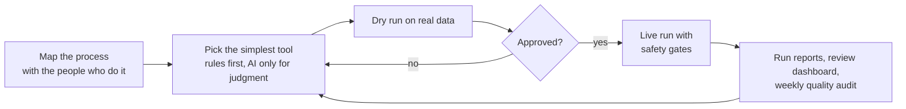

# AI systems portfolio: Aleksandra Grechuta

I design and run AI and automation systems for real customer and business operations. I map the process first, use simple rule-based scripts where they are enough, and use large language models only where judgment is needed. Every system has a person in the loop: approval before anything goes live, then automated runs with reviews, quality audits and security controls.

The systems were designed by me and built with AI coding assistants (Claude Code). I defined the problems, rules and safety limits, reviewed results against real data, caught bugs, approved every live step, and I operate them day to day.

The source code lives in private repositories, because it holds client and business data. This repository shows how each system works. Code walkthroughs are available on request in an interview.

**Code:** [CX automation in code](code/), in Python with tests. Two sides of customer communication: [answering](code/support/) (support automation with filtering, safety rules, the helpdesk API connection and a performance review, reproducing the live results) and [reaching out](code/outreach/) (the send rules of the outreach pipeline, copied from the live code).

Website: [aleksandragrechuta.com](https://aleksandragrechuta.com) · LinkedIn: [linkedin.com/in/agrechuta](https://www.linkedin.com/in/agrechuta)

## Projects

| Project | What it does | Status |
|---|---|---|
| [Support triage automation](projects/01-support-triage-automation.md) | AI triage of a real support queue for a large online academy platform: 1,632 new tickets from 1 Sep to 22 Oct 2026, 75% answered or given a first reply at once. Answers only from approved replies; sensitive cases go to a person | Live |
| [B2B outreach pipeline](projects/02-b2b-outreach-pipeline.md) | Prospect research, personalised emails, follow-ups and AI-scored replies. Nothing is sent without approval | Live |
| [E-commerce operations system](projects/03-ecommerce-operations-system.md) | One source of truth for orders, costs, production, stock and margins across three sales channels | Live |
| [Website run by AI](projects/04-website-run-by-ai.md) | Shop rebuilt fully in code (own theme, custom blocks, six languages), approval-gated deploys, AI routines for site checks and blog drafts | Live |
| [AI image production system](projects/05-ai-image-production.md) | Brand rules, product fact sheets and a tested prompt library so AI images never change the real product | In use |
| [AI job-search assistant](projects/06-job-search-assistant.md) | Imports job alerts, reads each role and drafts applications limited to verified facts | Live |

## How I build

## Tools used across these projects

Python, TypeScript, Google Apps Script, SQL, REST APIs · Claude and OpenAI APIs · Zendesk · WordPress block themes, WooCommerce, Shopify, GA4 · Google Sheets, Notion · GitHub Actions, Cloudflare Workers and D1 · Claude Code
