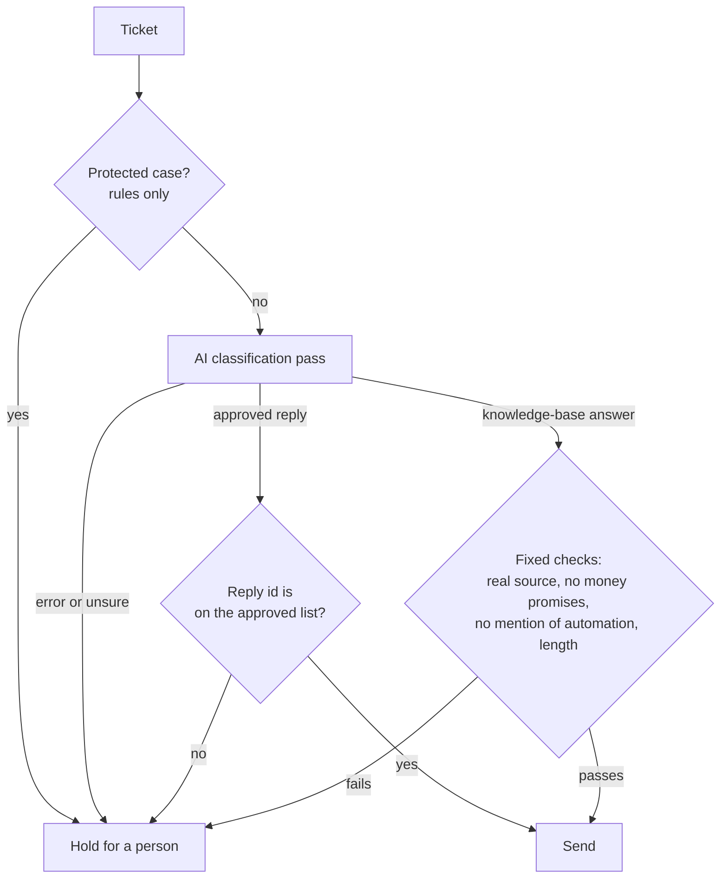

# Code sample: support triage routing rules

A small, standalone version of the routing rules behind the [support triage automation](../../projects/01-support-triage-automation.md). It shows how the system decides, for each ticket, whether it may be answered automatically or must go to a person.

The production system is private because it holds client data. This sample was written for this portfolio with an AI coding assistant, like the production code. All tickets, replies and knowledge-base entries in it are made up.

## How a ticket is routed



## What the rules guarantee

- **The AI never sees protected cases.** Refunds, billing disputes, unrecognised charges, lifetime memberships, legal or privacy requests and very frustrated customers are caught by rules first and held for a person.
- **The AI can only choose, not invent.** It may pick a reply a person has approved, or propose an answer that must cite a real knowledge-base entry. A made-up reply id or source is held.
- **Answers are checked before they are sent.** An answer that promises money, mentions AI or automation, or is too long is held.
- **Failure means a person, never a guess.** If the AI step fails or is unsure, the ticket is held.
- **Tickets close only on a real customer signal**, such as "Thank you!" or "It works now". "Thanks, but it still doesn't work" keeps it open.
- **Every run is checkable.** The run report lists every held ticket with its reason.

## Files

| File | What it is |
|---|---|
| [`routing.py`](routing.py) | The rules: safety gates, checks on the AI's choice, closing signal, run report |
| [`test_routing.py`](test_routing.py) | 15 tests, one for each rule above |

## Run the tests

Python 3.10 or newer, no other packages needed:

```bash
cd code-sample/triage
python3 -m unittest -v
```

The AI is passed into `route()` as a function, so the tests replace it with fixed answers and check the rules on their own. In the production system that function is one call to the Claude API.
