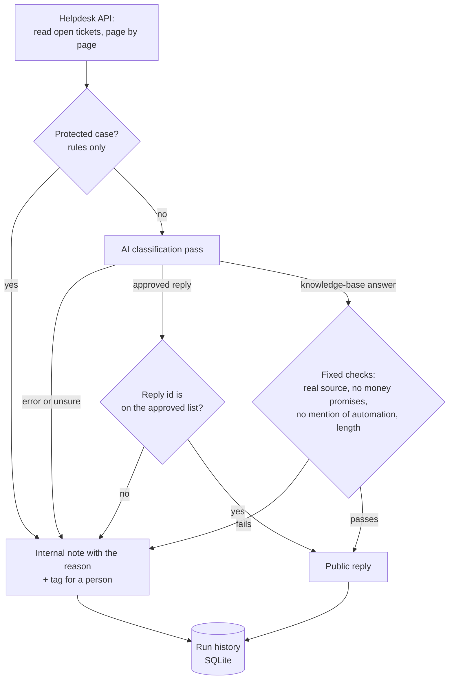

# Code sample: AI-assisted support triage

A small, standalone version of how the [support triage automation](../../projects/01-support-triage-automation.md) works: the rules that decide whether a ticket may be answered automatically or must go to a person, and the connection to the helpdesk that reads tickets, replies and keeps a run history.

The production system is private because it holds client data. This sample was written for this portfolio with an AI coding assistant, like the production code. It uses an online shop as the example, and all tickets, replies and knowledge-base entries are made up.

## How one run works



## What the rules guarantee

- **The AI never sees protected cases.** Refunds, billing disputes, unrecognised charges, damaged or wrong items, legal or privacy requests and very frustrated customers are caught by rules first and held for a person.
- **The AI can only choose, not invent.** It may pick a reply a person has approved, or propose an answer that must cite a real knowledge-base entry. A made-up reply id or source is held.
- **Answers are checked before they are sent.** An answer that promises money, mentions AI or automation, or is too long is held.
- **Failure means a person, never a guess.** If the AI step fails or is unsure, the ticket is held.
- **Tickets close only on a real customer signal**, such as "Thank you!" or "It works now". "Thanks, but it still doesn't work" keeps it open.

## How the connection works

- **HTTPS only, with certificate verification and a timeout** on every call. The API token is passed in, never written in the code.
- **Rate limits are respected.** On HTTP 429 the client waits as long as the helpdesk asks (Retry-After) and tries again, up to a limit. Server errors are retried with a growing wait. Wrong credentials stop at once.
- **Dry run first.** A dry run makes every decision but changes nothing in the helpdesk, so the decisions can be reviewed before a live run.
- **Held tickets get an internal note, never a public reply,** with the reason and a `needs-person` tag, so they appear in the person's view.
- **Every decision is saved** to a SQLite run history with its reason, and each run returns a report listing every held ticket.

## Files

| File | What it is |
|---|---|
| [`routing.py`](routing.py) | The rules: safety gates, checks on the AI's choice, closing signal, run report |
| [`helpdesk_api.py`](helpdesk_api.py) | Helpdesk REST API client (Zendesk-style endpoints): paging, rate limits, retries, replies and internal notes |
| [`run.py`](run.py) | One triage run: read, route, act (or dry run), save to the run history |
| [`test_routing.py`](test_routing.py) | 15 tests for the rules |
| [`test_api_and_run.py`](test_api_and_run.py) | 8 tests for the API client and full runs, with a fake helpdesk instead of the network |

## Run the tests

Python 3.10 or newer, no other packages needed:

```bash
cd code-sample/triage
python3 -m unittest -v
```

The AI and the HTTP layer are both passed in as functions, so the tests replace them with fixed answers and check the rules and the connection on their own. In the production system the AI step is one call to the Claude API.
