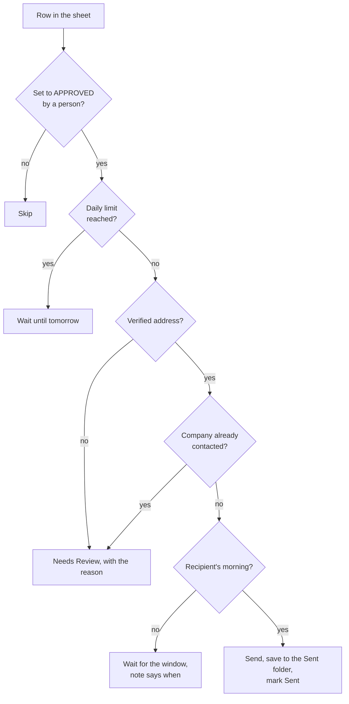

# Reaching out: outreach send rules, an excerpt of the live code

This is the reaching-out side of my [CX automation](../): the rules that decide when an email from my [B2B outreach pipeline](../../projects/02-b2b-outreach-pipeline.md) may go out, and how the inbox is read afterwards. Unlike the [support code](../support/), this is **copied from the real pipeline** (v6, which ran hourly on GitHub Actions from September 2026 and is paused since 21 October 2026 while I reorganise it). It was built with an AI coding assistant, like all my systems.

The full pipeline is about 2,600 lines and stays private, because it works on real contacts. This excerpt contains only the functions below, unchanged apart from one shortened comment, plus one short function (`send_decision`) that shows the order of the checks without the Google Sheets and mail-server calls.

## Why these rules exist

The pipeline researches stores, drafts a personal email for each one with AI, follows up after 7 days and reads the replies. It is used by me and our sales representative. Cold email can go wrong in ways that hurt the brand: a message to the wrong address, the same store contacted twice, a robotic phrase, an email arriving at 3 a.m. their time. Each rule below prevents one of those.

## The rules

| Rule | Function | What it prevents |
|---|---|---|
| **Nothing goes out without a person's approval** | `send_decision` | The robot drafts; a person sets the row to APPROVED. Anything else is skipped. |
| **Writing rules on every draft** | `check_text_rules`, `BANNED_WORDS` | Drafts with sales clichés ("stunning", "elevate your space", "I wanted to reach out"), or words that are wrong for the brand, or em dashes. A draft that breaks a rule goes to Needs Review instead of Draft Ready, before anyone can approve it. |
| **Only a verified address** | `send_address` | Mailing a guessed address. The address must be at the start of the Email cell; notes like "Not found (listings suggest info@...)" are never mailed. |
| **Never the same company twice** | `company_key`, `already_contacted` | Contacting a store again from another list. Companies are matched by website domain, or by email domain unless it is gmail or a similar provider. Writing "send anyway" overrides it on purpose. |
| **The recipient's morning** | `in_send_window`, `contact_tz`, `parse_send_window` | Emails arriving at night or on a weekend. The window is a setting in the sheet (Mon-Fri 09:00-12:00), judged in the recipient's time zone by country, with the Canary Islands handled separately. If no hourly run can ever reach a window, the email is not held forever. |
| **A daily limit per mailbox** | `send_decision` | Sending too much in one day, which hurts deliverability. The limit is a setting in the sheet. |
| **Bounces are recognised** | `is_bounce`, `bounce_reason` | Treating "delivery failed" as a reply. A permanent bounce (5.x.x) marks the address as not working; a temporary one (4.x.x) only notes the delay. |
| **Automatic replies are not real replies** | `auto_reply_kind` | Counting an out-of-office message (in several languages) or an anti-spam "confirm you are human" request as a real answer. |

## The order of checks before a send



## Files

| File | What it is |
|---|---|
| [`send_rules.py`](send_rules.py) | The excerpt: writing rules, send window, address and duplicate checks, bounce and auto-reply detection, and the order of checks |
| [`test_send_rules.py`](test_send_rules.py) | 22 tests, with made-up stores and addresses |

## Run the tests

Python 3.10 or newer, no other packages needed:

```bash
cd code/outreach
python3 -m unittest -v
```
