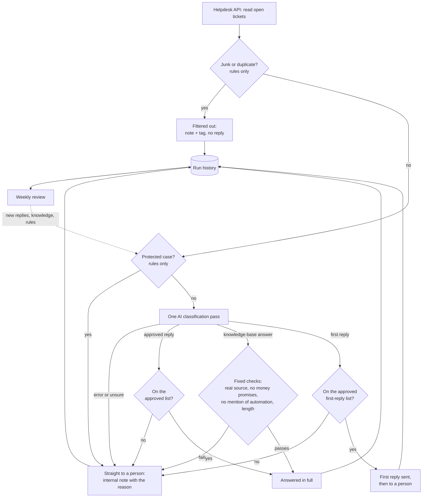

# Support triage: how it works, in code

This is a small, standalone version of the [support triage automation](../../projects/01-support-triage-automation.md) I run on a live support queue for a large online academy platform. From 1 September to 22 October 2026 that system handled **1,632 new tickets**, and **75% were answered or given a first reply at once**.

The production code is private because it holds client data. This version was written for this portfolio with an AI coding assistant, the same way I build the production system. It follows the same design and reproduces the same numbers, but it uses an online shop as the example, and every ticket and reply in it is made up.

## The problem it solves

One person runs the support queue. Before the automation, customers waited more than 7 days for an answer, although most tickets were repeat questions with a known correct answer. The goal was not to replace the person, but to make sure that:

- simple questions get a correct answer at once;
- everything else gets an immediate first reply, so the customer is not left waiting;
- the person only spends time on cases that need judgment;
- junk never reaches anyone.

## What happens to one ticket

Every ticket ends in exactly one of four outcomes. The real results from the live system are next to each one.

| Outcome | What happens | Live results, 1 Sep to 22 Oct |
|---|---|---|
| **Answered in full** | The AI picked an approved reply, or a knowledge-base answer passed every check. The customer gets the answer at once. | 557 (34%) |
| **Immediate first reply, then a person** | The case needs a person, but the customer gets an approved first reply at once (in this example shop, a request for the order number), so the person can finish it quickly. | 664 (41%) |
| **Sent straight to a person** | Money, privacy, a very frustrated customer, or anything unclear. Nothing automatic is sent. | 73 (4%) |
| **Filtered out** | Auto-replies, newsletters, sales pitches and duplicates. Set aside, never answered. | 338 (21%) |
| | | **1,632** |



## The design choices, and why

**Rules first, AI only for judgment.** Filtering junk and catching protected cases (refunds, billing disputes, unrecognised charges, damaged items, legal or privacy requests, very frustrated customers) is done with plain rules before the AI sees anything. Rules are predictable, free and testable. The AI is used for the one step that needs judgment: understanding what the customer is asking.

**The AI chooses, it does not write freely.** It can pick a reply a person has written and approved, propose an answer that must cite a real knowledge-base entry, pick an approved first reply, or say it is unsure. A reply or source that does not exist is caught and the ticket goes to a person.

**Safety lives in code, not in the prompt.** An answer that promises money, mentions AI or automation, or is too long is blocked by a fixed check, whatever the AI says. A prompt can be ignored; code cannot.

**Failure means a person, never a guess.** If the AI call fails or times out, the ticket goes to a person with the reason.

**Tickets close only on a real customer signal.** "Thank you!" closes a ticket; "Thanks, but it still doesn't work" keeps it open.

**Dry run first.** Every run can be a dry run: it makes all the decisions and saves them, but changes nothing in the helpdesk, so I can check the decisions before a live run.

## How it connects to the helpdesk

`helpdesk_api.py` talks to the helpdesk's REST API (Zendesk-style endpoints):

- reads all open tickets, page by page;
- uses HTTPS only, with certificate verification and a timeout on every call; the API token is passed in, never written in the code;
- respects rate limits: on HTTP 429 it waits as long as the helpdesk asks (Retry-After) and tries again, up to a limit; server errors are retried with a growing wait; wrong credentials stop at once;
- answers with a public reply, or adds an internal note with a tag (`needs-person` or `filtered`), so the person's view shows only what is theirs.

`run.py` does one full run: read the tickets, spot duplicates (same customer, same question), route each ticket, act on it (or not, in a dry run), and save every decision with its reason to a SQLite run history.

## How performance is reviewed

`review.py` turns the run history into a report for any period, usually a week, compared with the period before:

- **the four outcomes**, with counts and shares;
- **needs attention first:** AI failures, and AI choices the rules had to block;
- **why tickets went to a person**, each reason with its count, so a rising one shows up early;
- **which approved replies** do the most work;
- **knowledge gaps:** questions the AI could not answer from the knowledge base, so I know which entry to add or improve;
- **a quality audit sample:** random automatic answers for a person to re-read; the same period always gives the same sample, so the audit can be checked later.

What the review finds goes back into the system as a new approved reply, a better knowledge-base entry, or a new rule with a test. In the live system the weekly audits have found no errors so far.

### The real numbers, reproduced

`demo.py` rebuilds a run history with the live system's real totals (placeholder tickets, real counts) and runs the review on it. This is its output:

```text
# Review, 2026-09-01 to 2026-10-22

| Outcome | Tickets | Share |
|---|---|---|
| Answered in full | 557 | 34% |
| Immediate first reply, then a person | 664 | 41% |
| Sent straight to a person | 73 | 4% |
| Junk, duplicates and business mail filtered out | 338 | 21% |
| **All tickets** | **1632** | |

**Answered or given a first reply at once: 1221 (75%).**

# Review, 2026-10-01 to 2026-10-22

| Outcome | Tickets | Share | Period before |
|---|---|---|---|
| Answered in full | 162 | 25% | 395 (41%) |
| Immediate first reply, then a person | 297 | 45% | 367 (38%) |
| Sent straight to a person | 43 | 7% | 30 (3%) |
| Junk, duplicates and business mail filtered out | 158 | 24% | 180 (19%) |
| **All tickets** | **660** | | **972** |

**Answered or given a first reply at once: 459 (70%).**
```

September includes clearing the old backlog: the first live run over the whole queue handled 337 tickets with zero errors.

## Files

| File | What it is |
|---|---|
| [`routing.py`](routing.py) | The rules: filtering, safety gates, checks on the AI's choice, closing signal, run report |
| [`helpdesk_api.py`](helpdesk_api.py) | Helpdesk REST API client: paging, rate limits, retries, replies, internal notes, tags |
| [`run.py`](run.py) | One triage run: read, spot duplicates, route, act (or dry run), save to the run history |
| [`review.py`](review.py) | Performance review for any period, as data and as a Markdown report |
| [`demo.py`](demo.py) | Reproduces the review with the live system's real totals |
| [`test_routing.py`](test_routing.py) | 20 tests for the rules |
| [`test_api_and_run.py`](test_api_and_run.py) | 10 tests for the API client and full runs, with a fake helpdesk instead of the network |
| [`test_review.py`](test_review.py) | 9 tests for the review, including that the demo reproduces the real totals exactly |

## Run it

Python 3.10 or newer, no other packages needed:

```bash
cd code/triage
python3 -m unittest -v   # 39 tests
python3 demo.py          # the review with the real totals
```

The AI and the HTTP connection are both passed in as functions, so the tests replace them with fixed answers and check the rules and the connection on their own. In the production system, the AI step is one call to the Claude API per ticket, at about 1 cent per ticket.
