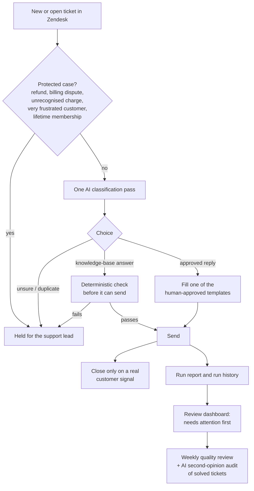

# Support triage automation

**Context:** independent client work for a large online academy platform. **Status:** live since August 2026. Runs are started by hand after a dry run, never on a schedule.

## The problem

One support lead (me) runs the customer support queue in Zendesk. Customers were waiting more than 7 days for an answer. Most tickets were repeat questions with a known correct answer, but every ticket still needed a person to read it.

## What I built

AI triage that answers only from approved replies and a curated knowledge base. Sensitive cases always go to a person. It automates triage, not judgment.

## Design choices

- **Constrained AI.** The model may only pick from a fixed set of human-approved replies (18 templates) or answer from the knowledge base. It never writes free text to a customer without a deterministic check.
- **Safety gates in code, not in the prompt.** Refunds, disputes and other protected cases are caught by rules before the AI sees them.
- **Dry run first.** Every run can be done as a dry run. One dry run over 332 tickets found 22 real duplicates, and all were correctly held for review.
- **Everything is checkable.** A report for every run, a run history, a review dashboard, a weekly quality review and an AI audit that re-reads solved tickets. Every bug found became a regression test.
- **Security.** Keys in a separate auto-locking keychain, dedicated expiring keys, a monthly API spend limit, Zendesk rate limiting, certificate verification on every API call.
- **Cost.** About 1 cent of AI cost per ticket.

## Results

- Cleared the support backlog, roughly the workload of one full-time agent. Nobody was removed from a role.
- Largest live run: 337 tickets with zero errors, 177 of them answered with approved replies.
- No errors found in weekly quality audits.

## Incident review

After a customer incident, I led a review of the full ticket history (1,995 tickets) for refund confirmations that had never been verified. The findings became permanent safety checks in the system.

## Stack

Zendesk API · Claude API · SQLite (run history) · Notion (weekly review) · Claude Code
