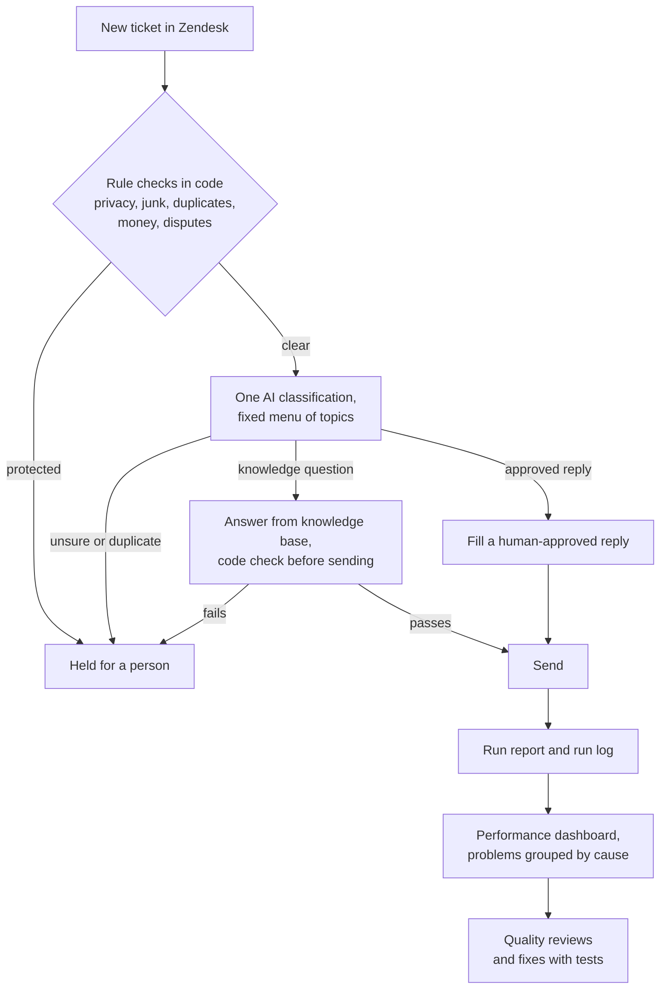

# Support triage automation

**Context:** independent client work for a large online academy platform. I run the support queue alone, in Zendesk, and I designed this system, built it with AI coding assistants and operate it.

**Status:** live. First scripts May 2026, current version live since 18 September 2026, new-ticket intake running every hour since 21 October 2026.

## The problem

Customers were waiting more than 7 days for an answer. Most tickets were repeat questions with a known correct answer, but some involved money, privacy or a person in difficulty, and those could never get a template.

## How it runs

| Question | Answer |
|---|---|
| Where it runs | On my own machine, as Python scripts. This was a deliberate choice: the keys and customer data stay on one machine until the client's IT and privacy review agrees to something else. Moving it to the cloud is the next step, not done yet |
| What triggers it | New tickets: a scheduled job every hour, at most 30 tickets a run. Open tickets, follow-ups and summary notes: I start these by hand, after a dry run, about once a day |
| What it is allowed to do | Pick from human-approved replies, or answer from a curated knowledge base after a code check. Refunds, disputes, privacy and anything uncertain go to a person |
| How I know it failed | Every run writes a report and a row in a run log. A failed hourly run raises a notification. A run stops itself when API credit runs out, a key is refused, or 3 tickets in a row lose the connection |
| What it does not catch yet | Alerts live on one machine. If that machine is asleep the schedule does not fire, and nothing tells me |

## What I built

## Design choices

- **Safety gates in code, not in the prompt.** Money and privacy are caught by plain rules before the AI sees the ticket, and those rules can only move a ticket toward a person.
- **Never confirm what has not been verified.** A ticket that claims a refund or cancellation is done cannot close without the payment system's own confirmation note.
- **Every fix gets a test.** 369 automated tests, using real customer wording with personal data removed. I also remove a fix on purpose to prove the test catches it.
- **Dry run first.** Every script can run without writing anything.
- **Security.** Separate, expiring keys, a separate key store, a spend limit, rate limiting and a run lock so two runs can never answer the same ticket.

## Results

From 1 September to 31 October 2026, live runs only, from the system's own run log:

| | September | October | Total |
|---|---|---|---|
| New tickets | 972 | 994 | **1,966** |
| Junk, duplicates and business mail filtered | 180 | 269 | **449** |
| Real customer requests | 792 | 725 | **1,517** |
| Answered in full | 395 | 240 | **635** |
| First reply at once, then a person | 367 | 422 | **789** |
| Straight to a person | 30 | 63 | **93** |

**How to read this honestly.** The September figure includes 204 replies from a one-off pricing notice that ended on 21 September. Those asked a question rather than solving anything, so they should not count as resolved. Without them, the full-answer rate is steady at about one in three real requests: 32% in September, 33% in October.

What I do not measure yet: reopen rate per flow, handover quality, and true cost per contact. My early estimate of about 1 cent of AI cost per ticket was rebuilt from the prompts and left out dry runs and reviews, so I do not quote it as a result.

## What broke, and what I changed

- **A refund that was promised but never verified.** With the older tooling, a customer was told a refund was done and the ticket closed without it being issued. It took 16 days to reach them. I reviewed 1,995 historical tickets, found 4 high-confidence late cases and 106 lower-confidence flags, and built the verification rule above. A later check on the wording showed the rule had been missing everyday phrases, so I widened it and measured it against 972 tickets.
- **Runs failed quietly.** A lost connection could fail every remaining ticket while the run still looked finished, and a broken run in September, probably the laptop sleeping, left about two days without intake. On one day the API credit ran out mid-run. Now a run stops itself, says why, and picks the tickets up next time. The dashboard groups all problems by cause.
- **Automated replies that missed the customer's words.** 14 of 29 customers who got a cancellation how-to had asked for a refund in their reply. The system had only read their first message. I added a code check on the customer's own words, tested on those real cases: it flagged all 14 and none of the 15 plain cancellations.

## What the audit found

In September I audited all 300 live replies sent so far, with a second AI reviewer and then a fact check of its findings. It flagged 126 replies, and the facts behind 104 held up. That does not make all 104 mistakes, because many were judgment calls, so each one went into a review list for a human decision. The audit tool itself needed six bug fixes first, including a first pass that reported 169 flags because the reviewer was reading events from after the reply.

The result changed the system: 57 of the 104 can no longer happen (the offer ended, or the case now goes to a person). The main remaining issue was one template that was too generic, which I treat as the next thing to improve.

## What I'd change next

- Move to a managed cloud job with alerts that do not depend on one machine, after a privacy review.
- Log tokens and cost per run, so cost per contact is measured.
- Track reopen rate and CSAT per flow, and widen knowledge answers topic by topic as they earn it.

## Stack

Python · Zendesk API · Claude API · SQLite (run log) · Notion (reviews) · Claude Code
