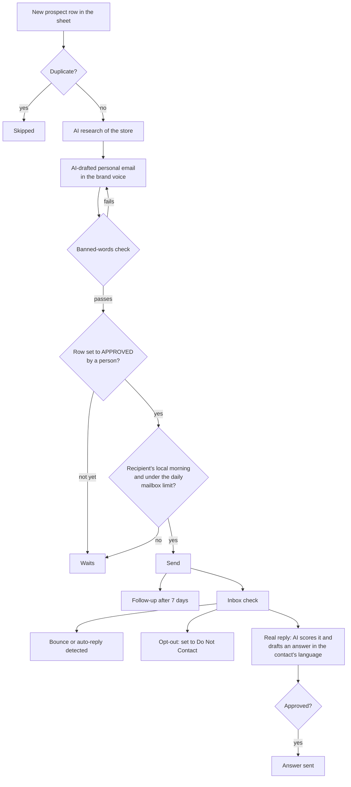

# B2B outreach pipeline (Mur Mur Objects)

**Context:** my own lighting brand, [murmurobjects.com](https://murmurobjects.com). **Status:** live; the current version (v6) runs since September 2026. It replaced an earlier Google Apps Script version.

## The problem

Wholesale growth depends on writing to many independent shops, following up and answering replies quickly. It is work for two people: me and our sales representative. It needs to sound personal and on-brand, and nothing should go out by mistake.

## What I built

A Python pipeline that runs every hour on GitHub Actions and works from a Google Sheet (one tab per sender, plus press and influencers).

## Design choices

- **Nothing reaches a real contact without approval.** First emails and reply answers both wait for a person.
- **Sends like a person would.** Only in the recipient's local morning, and within a daily limit per mailbox.
- **Brand voice is enforced.** Drafts are checked against a banned-words list before they can be approved.
- **Inbox hygiene is automatic.** Bounces, auto-replies and opt-outs are handled without manual work.

## Code

The send rules, copied from the live pipeline, with tests: [code/outreach](../code/outreach/).

## Stack

Python · Claude API · Google Sheets API · Gmail · GitHub Actions · Claude Code
