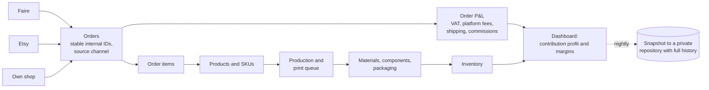

# E-commerce operations system (Mur Mur Objects)

**Context:** my own lighting brand. **Status:** live since July 2026.

## The problem

Orders arrive from three channels (Faire wholesale, Etsy and our own shop). Each lamp is 3D-printed in-house. To know real margins I need orders, costs, production, materials and stock in one place.

## What I built

One connected workbook that is the single source of truth for revenue, costs, production and stock. It deliberately uses formulas and scripts, not AI: the simplest technology that solves the problem well.

## Design choices

- **Stable internal order IDs** so the same order is never counted twice across syncs.
- **Reconciliation** of calculated totals against each platform's own totals.
- **Field documentation and sync logs** inside the workbook, so it can be handed over.
- **Nightly backup** to a repository, with full change history.

## Stack

Google Sheets · Google Apps Script · GitHub Actions
