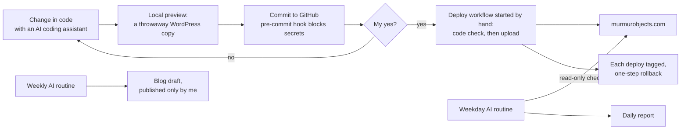

# Website run by AI (Mur Mur Objects)

**Context:** [murmurobjects.com](https://www.murmurobjects.com), my brand's WooCommerce shop. **Status:** live. The site is now fully defined in code, and AI routines check it and help write content.

## The problem

The old site was built with a page builder (Elementor) and about 35 plugins: heavy, slow and hard to change safely. I wanted the same look, a much lighter site, easy editing for me, and every change reviewable before it reaches customers.

## What I built

I designed the new site and built it with AI coding assistants (Claude Code). Everything that shapes the site lives in a private GitHub repository. Products, pages, orders and customer data stay in WordPress and never enter the repository.

- **Own block theme:** design system (colours, fonts, three title levels), header, footer, shop, product and checkout templates.
- **Custom blocks:** hero video (a still image on phones), a lamp grid with live prices, category tabs and a site-wide Day/Night switch, category tiles, product specs, a free-shipping bar.
- **"Style your wall":** visitors drag lamps at true size onto a wall, switch to night to see them glow, and add them to the bag.
- **Six languages:** English, Spanish, Polish, French, Italian and Catalan, with their own addresses and hreflang.
- **Analytics and attribution:** GA4 e-commerce events with consent mode, order attribution, traceable Instagram links (UTM), Google Merchant Center.

## Design choices

- **Nothing reaches the live site without my yes.** Deploys only run when started by hand, check the code first and are tagged, so any earlier version can be put back in one step.
- **No secrets in the repository.** A pre-commit hook blocks keys and config files. The deploy login can only reach the site's theme and plugin folders.
- **Keep it light.** No page builder, and no new plugin when a block or a few lines of code will do.
- **AI checks, people decide.** The daily health check is read-only and only reports problems. Blog posts are saved as drafts for me to edit and publish.
- **No dark patterns.** No fake countdowns or pre-ticked boxes; EU consumer and privacy rules apply.

## Stack

WordPress block theme (PHP, CSS, JavaScript) · WooCommerce · GitHub Actions · GA4 · Google Merchant Center · Claude, Claude Code
