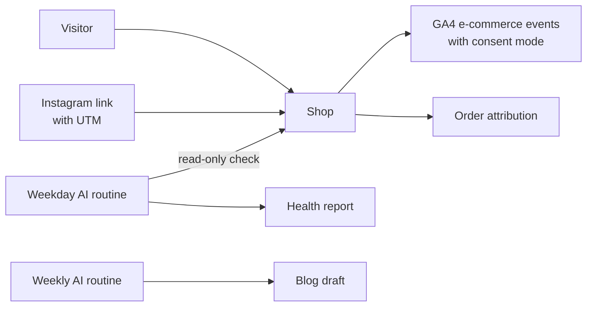

# Website run by AI (Mur Mur Objects)

**Context:** [murmurobjects.com](https://murmurobjects.com), my brand's WooCommerce shop. **Status:** live since July 2026.

## What I set up

- **Analytics and attribution:** GA4 with e-commerce events (view item, add to cart, begin checkout, purchase), a consent-mode cookie banner, WooCommerce order attribution and traceable Instagram links (UTM redirects).
- **Shopping feed:** Google Merchant Center tag.
- **Scheduled AI routines:** a weekday read-only website health report and a weekly blog post.

## Design choice

The health check is **read-only**: it reports problems and never changes the live site by itself.

## Stack

WordPress · WooCommerce · GA4 · Google Merchant Center · Claude
