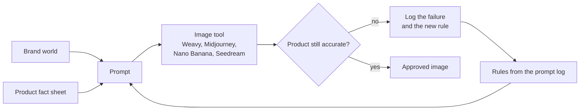

# AI image production system (Mur Mur Objects)

**Context:** product and campaign imagery for my lighting brand. **Status:** in use.

## The problem

AI image tools are fast, but they tend to redraw the product. For a real product that is sold online, the image has to show exactly what the customer receives.

## What I built

- **Brand world:** core idea, seasonal colour palettes, type, photography rules and a casting guide.
- **A fact sheet per product**, so AI images never change the real product.
- **A dated prompt log:** model and settings per run, results, what failed and the rule learned from it. For example: "match the reference photo's camera angle and light, or the model redraws the product".

## Stack

Weavy · Midjourney · Nano Banana · Seedream
