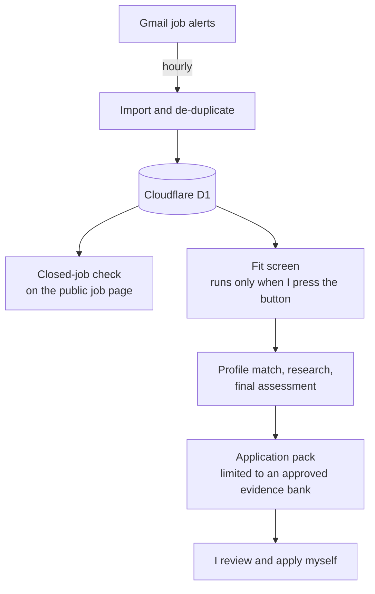

# AI job-search assistant

**Context:** personal project, an AI research tool for job-market analysis. **Status:** live since August 2026, behind a login.

## What it does

- Imports LinkedIn job alerts from Gmail every hour.
- Reads each job description and checks whether the posting has closed.
- Screens fit against my verified experience, with fixed rules and AI.
- Researches the company and role, then drafts an application pack that may only use approved facts.
- It drafts. It never submits an application.

## Design choices

- **No automatic AI spending.** The hourly job only imports and checks closed jobs. AI steps run when I choose how many.
- **Evidence-bound writing.** Drafts can only use facts from an approved evidence file, so nothing is invented.
- **Cost controls.** Prompt caching, a cheaper model for screening and the strongest model only for writing; retry limits; spend limits stop a run.
- **Automated tests** before every deploy.

## Stack

TypeScript · Cloudflare Workers and D1 · Cloudflare Access · Claude and OpenAI APIs · Gmail · Claude Code
